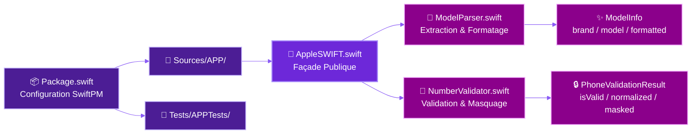

<div align="center">

# 🌌 AppleSWIFT
### Mini‑Framework Swift Ultra‑Léger, Sécurisé & Modulaire

⚡ **Parsing de modèles iPhone**
🔢 **Validation & Masquage RGPD**
🧩 **Micro‑Framework SwiftPM**

<br />

<p>
  
  
  
  
  
  
  
  
</p>

[Présentation](#-présentation) •
[Architecture](#-architecture-du-dépôt) •
[Sécurité](#-sécurité-et-bonnes-pratiques) •
[Installation](#-installation) •
[Usage](#-usage-rapide) •
[Roadmap](#-feuille-de-route)

</div>

---

## 📑 Sommaire

- [📱 Présentation](#-présentation)
- [✨ Fonctionnalités](#-fonctionnalités)
- [🧩 Architecture du dépôt](#-architecture-du-dépôt)
- [🔒 Sécurité et Bonnes Pratiques](#-sécurité-et-bonnes-pratiques)
- [📦 Installation](#-installation)
- [🚀 Usage rapide](#-usage-rapide)
- [🧭 Feuille de route](#-feuille-de-route)
- [📜 Gouvernance et Licence](#-gouvernance-et-licence)

---

## 📱 Présentation

**AppleSWIFT** est un *mini‑framework Swift ultra‑léger*, conçu pour offrir une base saine, thread‑safe (`Sendable`) et sans aucune dépendance externe pour :

- 📱 **Analyser et extraire** les marques et modèles d'appareils (*ex. iPhone 14 Pro, Samsung Galaxy S21*).
- 🔢 **Valider, normaliser et masquer** des numéros de téléphone selon un format E.164 simple.
- 🎨 **Formater** proprement les chaînes d'appareils (`formatModel`).
- 🏗️ **Servir de socle modulaire** à un futur framework Apple complet.

> [!NOTE]
> **Philosophie v1.1.0** : 100 % Swift Standard Library (zéro dépendance, pas même `Foundation`), compatible **Swift Package Manager**, avec tests unitaires inclus.

---

## ✨ Fonctionnalités

| Fonctionnalité | Description | Fichier source (`Sources/APP/`) |
| :--- | :--- | :--- |
| 🧩 **Façade unifiée** | Point d'entrée public `Sendable` exposant validation, parsing et formatage | `AppleSWIFT.swift` |
| 📱 **Parsing de modèles** | Extraction structurée (`brand`, `model`, `formatted`) avec garde‑fou O(1) | `ModelParser.swift` |
| 🔢 **Validation & Masquage RGPD** | Normalisation, validation ASCII stricte et propriété `masked` anti‑fuite | `NumberValidator.swift` |

---

## 🧩 Architecture du dépôt

### 📊 Flux interne du framework



### 📂 Arborescence complète

```text
AppleSWIFT/
├── Package.swift
├── README.md
├── structure.md
├── .github/
│   └── PULL_REQUEST_TEMPLATE.md
├── Sources/
│   └── APP/
│       ├── AppleSWIFT.swift
│       ├── ModelParser.swift
│       └── NumberValidator.swift
└── Tests/
    └── APPTests/
        └── AppleSWIFTTests.swift
```

<details>
<summary>🔍 <strong>État des composants du dépôt (v1.1.0)</strong></summary>

<br />

| Élément | Statut | Rôle dans le dépôt |
| :--- | :---: | :--- |
| `Package.swift` | ✔️ Présent | Configuration SwiftPM (module `AppleSWIFT`, 0 dépendance) |
| `README.md` | ✔️ Présent | Documentation principale (v1.1.0) |
| `structure.md` | ✔️ Présent | Référentiel de l'arborescence du projet |
| `Sources/APP/` | ✔️ Présent | Cœur du framework (`AppleSWIFT.swift`, `ModelParser.swift`, `NumberValidator.swift`) |
| `Tests/APPTests/` | ✔️ Présent | Suite de tests unitaires `XCTest` (`AppleSWIFTTests.swift`) |
| `.github/` | ✔️ Présent | Gouvernance et modèle `PULL_REQUEST_TEMPLATE.md` |

</details>

---

## 🔒 Sécurité et Bonnes Pratiques

- 🛡️ **Zero-Dependency Security** : aucune bibliothèque tierce dans `Package.swift` (surface d'attaque nulle côté dépendances).
- 🕶️ **Masquage RGPD (`masked`)** : les numéros valides sont masqués automatiquement (`+336******78`) et les entrées invalides retournent `"***"` afin de ne jamais exposer de données sensibles dans les logs.
- ⚡ **Garde‑fous O(1)** : vérification instantanée de la taille UTF‑8 (`utf8.count`) avant tout traitement de chaîne.
- 🔐 **Traitement 100 % local** : aucun appel réseau, aucune télémétrie.
- 🧵 **Swift Concurrency (`Sendable`)** : toutes les structures publiques sont immuables et sûres entre threads/acteurs.

---

## 📦 Installation

### Via Swift Package Manager (SwiftPM)

Ajoutez le dépôt dans Xcode (`File > Add Package Dependencies...`) ou dans votre `Package.swift` :

```swift
dependencies: [
    .package(url: "https://github.com/teremuhamblin/AppleSWIFT", from: "1.1.0")
]
```

### Import du module

```swift
import AppleSWIFT
```

---

## 🚀 Usage rapide

```swift
import AppleSWIFT

let parser = AppleSWIFT()

// 1. Validation & masquage sécurisé d'un numéro
let number = parser.validateNumber("+33 6 12 34 56 78")
print(number.isValid)    // true
print(number.normalized) // Optional("+33612345678")
print(number.masked)     // "+336******78" (sûr pour les logs)

// 2. Parsing & formatage de modèle
let info = parser.parseModel("iPhone 14 Pro")
print(info.brand)        // "iPhone"
print(info.model)        // "14 Pro"
print(info.formatted)    // "iPhone 14 Pro"
```

> [!TIP]
> Lancez `swift test` à la racine du dépôt pour vérifier l'ensemble des scénarios de validation, parsing et sécurité.

---

## 🧭 Feuille de route

### ✅ Accompli (v1.0.0 → v1.1.0)
- [x] Squelette SwiftPM sans dépendances (`Sources/APP/`)
- [x] Masquage RGPD (`masked`), normalisation et garde‑fous O(1)
- [x] Conformité `Sendable` pour Swift Concurrency
- [x] Ajout de `Tests/APPTests/` et `.github/PULL_REQUEST_TEMPLATE.md`

### 🔮 Prochaines versions (v1.2.0+)
- [ ] 📱 Base interne des identifiants matériels Apple (`iPhone15,2` → `iPhone 14 Pro`)
- [ ] ⚙️ Modes `strict` / `permissif` configurables pour les formats internationaux
- [ ] ⌚ Support officiel `watchOS` et `visionOS`
- [ ] 🚀 Workflow CI GitHub Actions (`.github/workflows/swift.yml`)
- [ ] 🎨 Extensions SwiftUI pour affichage formaté

---

## 📜 Gouvernance et Licence

### 📁 Gouvernance
Les contributions s'appuient sur le modèle `.github/PULL_REQUEST_TEMPLATE.md`.

### ⚖️ Licence
Ce projet est distribué sous licence **APL‑FR v1.0** (*AppleSWIFT Personal License*) : libre, simple et utilisable dans tout contexte compatible.

---

<div align="center">

🌙 **AppleSWIFT v1.1.0** — *Crafted with Swift • Designed in France* 🇫🇷  
Ultra‑light • Ultra‑clean • Ultra‑modular  

**© 2026 — The MadDoG.tmdg**  
*Apple‑grade micro‑framework*

</div>
