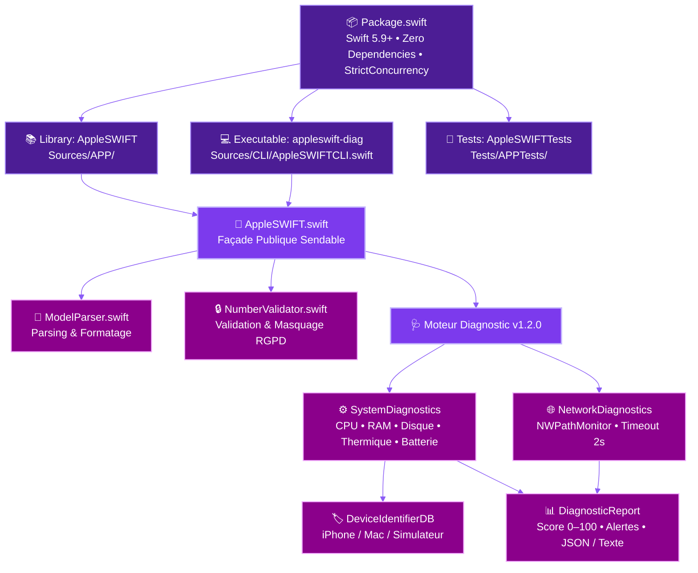

<div align="center">

# 🌌 AppleSWIFT
### *Suite de Diagnostic Apple, Parsing Matériel & Validation Sécurisée*

⚡ **Diagnostic iOS & macOS** &nbsp;•&nbsp; 📱 **Base Matérielle Apple** &nbsp;•&nbsp; 🔒 **Validation & Masquage RGPD** &nbsp;•&nbsp; 💻 **CLI `appleswift-diag`**

<br />

<p>
  
  
  
  
  
  
  
  
  
</p>

**[📱 Présentation](#-présentation)** &nbsp;┃&nbsp;
**[🩺 Diagnostic](#-suite-de-diagnostic)** &nbsp;┃&nbsp;
**[🧩 Architecture](#-architecture-modulaire)** &nbsp;┃&nbsp;
**[🔒 Sécurité](#-sécurité-et-confidentialité)** &nbsp;┃&nbsp;
**[📦 Installation](#-installation)** &nbsp;┃&nbsp;
**[🚀 Usage](#-usage-sdk-et-cli)** &nbsp;┃&nbsp;
**[🧭 Évolution](#-évolution-et-feuille-de-route)**

</div>

---

## 📑 Sommaire

- [📱 Présentation](#-présentation)
- [✨ Fonctionnalités complètes](#-fonctionnalités-complètes)
- [🩺 Suite de Diagnostic](#-suite-de-diagnostic)
- [🧩 Architecture modulaire](#-architecture-modulaire)
- [🔒 Sécurité et Confidentialité](#-sécurité-et-confidentialité)
- [📦 Installation](#-installation)
- [🚀 Usage SDK et CLI](#-usage-sdk-et-cli)
- [🧭 Évolution et Feuille de route](#-évolution-et-feuille-de-route)
- [📜 Gouvernance et Licence](#-gouvernance-et-licence)

---

## 📱 Présentation

**AppleSWIFT** a évolué d'un micro‑framework expérimental (`v1.0.0`) vers un moteur modulaire sécurisé (`v1.1.0`), puis vers une **suite complète de diagnostic matériel, système et réseau pour iPhone (iOS) et Mac (macOS)** (`v1.2.0`), le tout **sans aucune dépendance tierce**.

> [!NOTE]
> **ADN AppleSWIFT v1.2.0**
> - **Dual‑Product SwiftPM** : utilisable comme **SDK Swift** dans vos apps iOS/macOS/SwiftUI **et** comme **outil CLI Terminal** (`appleswift-diag`) sur macOS.
> - **Native‑Only Stack** : repose uniquement sur Swift Standard Library, `Foundation`, `Darwin` et les frameworks Apple natifs liés conditionnellement (`Network`, `IOKit`, `UIKit`).
> - **Zero‑Trust & Privacy‑First** : aucun serveur distant, aucune télémétrie, masquage automatique des données personnelles.

---

## ✨ Fonctionnalités complètes

| Domaine | Capacité | Origine | Module (`Sources/`) |
| :--- | :--- | :---: | :--- |
| 🧩 **Façade Unifiée** | Point d'entrée `Sendable` regroupant parsing, validation et diagnostic `async` | `v1.0.0` → `v1.2.0` | `APP/AppleSWIFT.swift` |
| 📱 **Parsing & Formatage** | Extraction structurée (`brand`, `model`, `formatted`) avec garde‑fou O(1) | `v1.0.0` → `v1.1.0` | `APP/ModelParser.swift` |
| 🔢 **Validation & Masquage RGPD** | Normalisation E.164, filtre ASCII strict et sortie `masked` (`+336******78`) | `v1.0.0` → `v1.1.0` | `APP/NumberValidator.swift` |
| 🏷️ **Base Matérielle Apple** | Résolution des codes bruts (`iPhone16,1` → `iPhone 15 Pro`, `Mac14,2`, Simulateur) | `v1.2.0` | `APP/Diagnostics/DeviceIdentifierDB.swift` |
| ⚙️ **Télémétrie Système** | Audit CPU, RAM, stockage disque, état thermique, mode éco, uptime & batterie | `v1.2.0` | `APP/Diagnostics/SystemDiagnostics.swift` |
| 🌐 **Audit Réseau Temps Réel** | Statut `NWPathMonitor`, Wi‑Fi/Cellulaire/Ethernet, IPv4/IPv6, Low Data Mode | `v1.2.0` | `APP/Diagnostics/NetworkDiagnostics.swift` |
| 📊 **Rapport & Score Santé** | Calcul de score `0–100`, alertes automatiques, export Texte & JSON | `v1.2.0` | `APP/Diagnostics/DiagnosticReport.swift` |
| 💻 **Logiciel Terminal macOS** | Exécutable CLI `appleswift-diag` (`--json`, `--device`, `--phone`, `--help`) | `v1.2.0` | `CLI/AppleSWIFTCLI.swift` |

---

## 🩺 Suite de Diagnostic

La suite de diagnostic évalue en parallèle (`async let`) l'état **système** et **réseau** de l'appareil afin de produire un `DiagnosticReport` structuré et exploitable :

- **Score de santé dynamique (`0–100`)** : pénalisation intelligente en cas de saturation disque (`>= 80%` / `>= 90%`), surchauffe thermique (`Élevé` / `Critique`), batterie faible non branchée (`<= 15%`) ou perte réseau.
- **Compatibilité multi‑plateformes native** :
  - **Sur iPhone / iPad (`iOS`)** : lecture de la batterie via `UIDevice` isolée proprement sur `@MainActor`, identification via `utsname` et détection automatique du Simulateur.
  - **Sur Mac (`macOS`)** : identification matérielle via `sysctlbyname("hw.model")` et lecture de l'alimentation/batterie via `IOKit.ps` (avec repli propre sur Mac fixe).
- **Double format de sortie** : rapport lisible en console (`formattedText()`) ou structuré pour l'automatisation (`toJSON()`).

<details>
<summary>🖥️ <strong>Aperçu d'un rapport généré par <code>appleswift-diag</code></strong></summary>

```text
==================================================
🌌 AppleSWIFT v1.2.0 — RAPPORT DE DIAGNOSTIC
==================================================
🕒 Date        : 2026-11-19T17:40:00Z
💚 Score Santé : 100/100

📱 APPAREIL & SYSTÈME
  • Modèle     : MacBook Air (M2, 2022) [Mac14,2]
  • OS         : macOS — Version 15.1
  • CPU / RAM  : 8/8 cœurs | 16.0 Go RAM
  • Stockage   : 214.5 Go libres / 494.38 Go (56.61% utilisé)
  • Thermique  : Nominal | Éco. énergie : Non
  • Uptime     : 14.25 h
  • Batterie   : 87% (En charge — AC Power)

🌐 RÉSEAU
  • Statut     : Connecté (Wi-Fi)
  • IPv4/IPv6  : IPv4=Oui | IPv6=Oui
  • Mode éco   : Désactivé | Coûteux : Non

🩺 DIAGNOSTIC & ALERTES
  [OK] Tous les indicateurs système et réseau sont sains.
==================================================
```

</details>

---

## 🧩 Architecture modulaire

### 📊 Pipeline Multi‑Produits & Flux d'Exécution



### 📂 Arborescence complète du dépôt (`v1.2.0`)

```text
AppleSWIFT/
├── Package.swift
├── README.md
├── structure.md
├── .github/
│   └── PULL_REQUEST_TEMPLATE.md
├── Sources/
│   ├── APP/
│   │   ├── AppleSWIFT.swift
│   │   ├── ModelParser.swift
│   │   ├── NumberValidator.swift
│   │   └── Diagnostics/
│   │       ├── DeviceIdentifierDB.swift
│   │       ├── SystemDiagnostics.swift
│   │       ├── NetworkDiagnostics.swift
│   │       └── DiagnosticReport.swift
│   └── CLI/
│       └── AppleSWIFTCLI.swift
└── Tests/
    └── APPTests/
        └── AppleSWIFTTests.swift
```

---

## 🔒 Sécurité et Confidentialité

La sécurité est intégrée à chaque couche depuis la `v1.1.0` et renforcée en `v1.2.0` :

- 🛡️ **Zero‑Dependency Supply‑Chain** : aucune dépendance externe dans `Package.swift`, réduisant à zéro le risque de compromission tierce.
- 🕶️ **Masquage RGPD (`masked`)** : les numéros validés sont automatiquement obfusqués (`+336******78`) et toute entrée invalide renvoie `"***"` pour empêcher la fuite de secrets dans les logs.
- ⚡ **Garde‑fous O(1) anti‑DoS** : contrôle instantané via `utf8.count` (`<= 64` pour numéros, `<= 128` pour modèles) avant toute allocation ou filtrage.
- ⏱️ **Timeout réseau garanti** : `NetworkDiagnostics` encapsule `NWPathMonitor` dans une `ContinuationBox` protégée par `NSLock` avec un timeout strict de **2 secondes** (aucun deadlock possible).
- 🧵 **Strict Concurrency (`Sendable`)** : toutes les structures publiques sont immuables, sûres entre threads et prêtes pour Swift 6.
- 🔐 **100 % Hors‑Ligne** : les diagnostics système et matériel restent strictement locaux à l'appareil.

> [!IMPORTANT]
> Les appels de diagnostic sur iOS/macOS n'utilisent que des API publiques documentées par Apple (aucune API privée), garantissant la conformité App Store pour vos applications iOS.

---

## 📦 Installation

### Via Swift Package Manager (SwiftPM)

Ajoutez le dépôt dans Xcode (<kbd>File</kbd> › <kbd>Add Package Dependencies...</kbd>) ou dans votre `Package.swift` :

```swift
dependencies: [
    .package(url: "https://github.com/teremuhamblin/AppleSWIFT", from: "1.2.0")
]
```

### Import du module

```swift
import AppleSWIFT
```

---

## 🚀 Usage SDK et CLI

### 1️⃣ Utilisation dans une app iOS / macOS (Swift & SwiftUI)

```swift
import AppleSWIFT

let app = AppleSWIFT()

// 1. Diagnostic complet asynchrone (Système + Réseau + Score)
let report = await app.runDiagnostics()
print("Modèle :", report.system.deviceName)
print("Score santé :", "\(report.healthScore)/100")
print(report.toJSON() ?? "{}")

// 2. Validation & masquage RGPD d'un numéro (v1.1.0)
let number = app.validateNumber("+33 6 12 34 56 78")
print(number.isValid)    // true
print(number.normalized) // Optional("+33612345678")
print(number.masked)     // "+336******78"

// 3. Parsing & formatage d'un appareil (v1.0.0 → v1.1.0)
let info = app.parseModel("  iPhone   14   Pro ")
print(info.brand)        // "iPhone"
print(info.model)        // "14 Pro"
print(info.formatted)    // "iPhone 14 Pro"
```

### 2️⃣ Utilisation en ligne de commande sur macOS (`appleswift-diag`)

```bash
# Compiler le SDK, la CLI et les tests
swift build

# Lancer un diagnostic système & réseau complet (format texte)
swift run appleswift-diag

# Exporter le diagnostic en JSON pour scripts ou support technique
swift run appleswift-diag --json

# Identifier un identifiant matériel Apple brut
swift run appleswift-diag --device "iPhone16,1"

# Valider et masquer un numéro de téléphone depuis le Terminal
swift run appleswift-diag --phone "+33 6 12 34 56 78"

# Exécuter la suite de tests unitaires
swift test
```

> [!TIP]
> Pour installer le binaire en local sur votre Mac après compilation : `swift build -c release` puis copiez `.build/release/appleswift-diag` dans `/usr/local/bin/`.

---

## 🧭 Évolution et Feuille de route

### 📜 Historique des versions

- **🚀 `v1.0.0` — Fondation** : squelette SwiftPM sans dépendances (`Sources/APP/`), validation basique de numéros et parsing simple de modèles.
- **🛡️ `v1.1.0` — Sécurité & Qualité** : masquage RGPD (`masked`), normalisation E.164, garde‑fous O(1), formatage `formatModel`, conformité `Sendable`, ajout de `Tests/APPTests/` et `.github/PULL_REQUEST_TEMPLATE.md`.
- **🩺 `v1.2.0` — Suite Diagnostic iOS & macOS** : moteur `SystemDiagnostics` + `NetworkDiagnostics`, base `DeviceIdentifierDB`, scoring santé `0–100`, export JSON, exécutable CLI `appleswift-diag`, support `watchOS`/`visionOS` et `StrictConcurrency`.

### 🔮 Prochaines étapes (`v1.3.0+`)

- [ ] 🧪 Extension des tests unitaires sur `DiagnosticReport` et `DeviceIdentifierDB`
- [ ] 🤖 Workflow CI GitHub Actions (`.github/workflows/swift.yml`) pour `swift build` & `swift test` automatisés
- [ ] 🎨 Composants **SwiftUI** prêts à l'emploi (jauge de santé, vue diagnostic iPhone/Mac)
- [ ] ⚙️ Modes `strict` / `permissif` configurables pour les indicatifs internationaux
- [ ] 🔒 Ajout de `SECURITY.md` et `CHANGELOG.md` dédiés

---

## 📜 Gouvernance et Licence

### 📁 Gouvernance
Les contributions suivent le modèle standardisé `.github/PULL_REQUEST_TEMPLATE.md` et doivent compiler sans avertissement sous `StrictConcurrency`.

### ⚖️ Licence
Ce projet est distribué sous licence **APL‑FR v1.0** (*AppleSWIFT Personal License*) : libre, simple et utilisable dans tout contexte compatible.

---

<div align="center">

🌙 **AppleSWIFT v1.2.0** — *Crafted with Swift • Designed in France* 🇫🇷  
**Ultra‑Light** &nbsp;•&nbsp; **Privacy‑First** &nbsp;•&nbsp; **Diagnostic‑Ready**

**© 2026 — The MadDoG.tmdg**  
*Apple‑grade micro‑framework & diagnostic suite*

</div>
