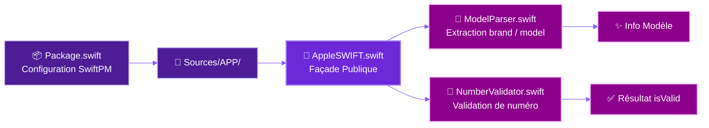

<!--Voici la mise à jour complète de **AppleSWIFT** vers la version **1.1.0**, présentée d'abord à travers une **Pull Request** structurée selon un `PULL_REQUEST_TEMPLATE` (prête à être utilisée ou enregistrée dans `.github/PULL_REQUEST_TEMPLATE.md`), suivie du nouveau fichier **`README.md` v1.1.0**.
-->

###### Nouveau `README.md` >> markdown
# Version 1.1.0

<div align="center">

# 🌌 AppleSWIFT

</div>

- **Mini‑Framework Swift**
- **Modulaire**
- **Parsing de modèles iPhone**
   - 🔢 *Validation de numéros*
   - 🧩 *Micro‑Framework SwiftPM*

<br />

<p>
  
  
  
  
  
  
  
</p>

<div align="center">
  
[Présentation](#-présentation) •
[Architecture](#-architecture-du-dépôt) •
[Sécurité](#-sécurité-et-bonnes-pratiques) •
[Installation](#-installation) •
[Usage](#-usage-rapide) •
[Roadmap](#-feuille-de-route)

</div>

---

## 📑 Sommaire

- [📱 Présentation](#-présentation)
- [✨ Fonctionnalités](#-fonctionnalités)
- [🧩 Architecture du dépôt](#-architecture-du-dépôt)
- [🔒 Sécurité et Bonnes Pratiques](#-sécurité-et-bonnes-pratiques)
- [📦 Installation](#-installation)
- [🚀 Usage rapide](#-usage-rapide)
- [🧭 Feuille de route](#-feuille-de-route)
- [📜 Gouvernance et Licence](#-gouvernance-et-licence)

---

## 📱 Présentation

**AppleSWIFT** est un *mini‑framework Swift ultra‑léger*, conçu pour offrir une base saine, lisible et sans dépendances externes pour :

- 📱 **Analyser et extraire** les marques et modèles d'appareils (*ex. iPhone 14 Pro, Samsung Galaxy S21*).
- 🔢 **Valider** des numéros de téléphone selon un format simple et rapide.
- 🎨 **Formater** des données essentielles pour un affichage propre.
- 🏗️ **Servir de socle modulaire** à un futur framework Apple plus complet.

> [!NOTE]
> **Philosophie v1.1.0** : Code minimaliste, 100 % compatible **Swift Package Manager**, sans aucune dépendance tierce afin de garantir légèreté, rapidité de compilation et maîtrise totale de la chaîne logicielle.

---

## ✨ Fonctionnalités

Chaque fonctionnalité est directement portée par un composant dédié du module `Sources/APP/` :

| Fonctionnalité | Description | Fichier source (`Sources/APP/`) |
| :--- | :--- | :--- |
| 🧩 **Façade unifiée** | Point d'entrée public exposant validation, parsing et formatage minimaliste | `AppleSWIFT.swift` |
| 📱 **Parsing de modèles** | Extraction structurée (`brand`, `model`) depuis une chaîne brute | `ModelParser.swift` |
| 🔢 **Validation de numéros** | Vérification simple et rapide du format des numéros de téléphone | `NumberValidator.swift` |

---

## 🧩 Architecture du dépôt

### 📊 Flux interne du framework



### 📂 Arborescence actuelle

```text
AppleSWIFT/
├── Package.swift
├── README.md
└── Sources/
    └── APP/
        ├── AppleSWIFT.swift
        ├── ModelParser.swift
        └── NumberValidator.swift
```

<details>
<summary>🔍 <strong>Détail de l'état des composants (basé sur structure.md)</strong></summary>

<br />

| Élément | Statut | Rôle dans le dépôt |
| :--- | :---: | :--- |
| `Package.swift` | ✔️ Présent | Déclaration SwiftPM du package, des produits et cibles (0 dépendance) |
| `README.md` | ✔️ Présent | Documentation principale du projet (v1.1.0) |
| `Sources/APP/` | ✔️ Présent | Cœur du module (`AppleSWIFT.swift`, `ModelParser.swift`, `NumberValidator.swift`) |
| `Tests/` | ❌ Absent | Dossier de tests unitaires SwiftPM à intégrer prochainement |
| `.github/` | ❌ Absent | Dossier destiné à la gouvernance (`PULL_REQUEST_TEMPLATE.md`, `SECURITY.md`, CI) |

</details>

---

## 🔒 Sécurité et Bonnes Pratiques

La version **1.1.0** met l'accent sur la fiabilité et la confidentialité dès la conception :

- 🛡️ **Zero-Dependency Security** : aucune bibliothèque tierce n'est importée dans `Package.swift`, éliminant les risques liés à la chaîne d'approvisionnement (*Supply-Chain*).
- 🔐 **Traitement 100 % local (Privacy-First)** : aucune donnée (numéro de téléphone ou identifiant d'appareil) ne transite sur le réseau ni n'est journalisée.
- 🧼 **Parsing défensif** : privilégiez des entrées nettoyées (suppression d'espaces/caractères superflus) et évitez tout déballage forcé (`!`) lors de l'extension des parsers.

> [!IMPORTANT]
> **Couverture de tests** : conformément à `structure.md`, le dossier `Tests/` n'est pas encore présent dans le dépôt. Pour un usage critique sur la validation de numéros, il est recommandé d'ajouter des tests unitaires avant déploiement en production.

---

## 📦 Installation

### Via Swift Package Manager (SwiftPM)

Ajoutez le dépôt directement dans Xcode (`File > Add Package Dependencies...`) ou dans votre `Package.swift` :

```swift
dependencies: [
    .package(url: "https://github.com/teremuhamblin/AppleSWIFT", from: "1.1.0")
]
```

### Import du module

```swift
import AppleSWIFT
```

---

## 🚀 Usage rapide

```swift
import AppleSWIFT

let parser = AppleSWIFT()

// 1. Validation d'un numéro de téléphone (NumberValidator)
let number = parser.validateNumber("+33612345678")
print("Numéro valide :", number.isValid)

// 2. Extraction marque & modèle (ModelParser)
let info = parser.parseModel("iPhone 14 Pro")
print("Marque :", info.brand) // "iPhone"
print("Modèle :", info.model) // "14 Pro"
```

> [!TIP]
> Pour étendre le comportement sans modifier la façade publique `AppleSWIFT.swift`, ajoutez vos nouvelles règles directement dans `ModelParser.swift` ou `NumberValidator.swift`.

---

## 🧭 Feuille de route

### ✅ Accompli (v1.0.0 → v1.1.0)
- [x] Squelette SwiftPM léger et sans dépendances (`Sources/APP/`)
- [x] Façade unifiée `AppleSWIFT`, `ModelParser` et `NumberValidator`
- [x] Documentation modernisée v1.1.0 avec sommaire opérationnel et schéma Mermaid

### 🔮 Propositions d'évolution (Prochaines versions)
- [ ] 🧪 **Création de `Tests/`** : suite de tests unitaires SwiftPM pour `ModelParser` et `NumberValidator`
- [ ] 🛡️ **Gouvernance `.github/`** : ajout de `PULL_REQUEST_TEMPLATE.md`, `SECURITY.md` et CI GitHub Actions (`swift build` / `swift test`)
- [ ] 📱 **Base interne de modèles Apple** : correspondance enrichie des générations iPhone / iPad / Mac
- [ ] ⚙️ **Modes `strict` / `permissif`** pour la validation et le formatage international des numéros
- [ ] ⌚ **Support étendu** : compatibilité officielle `watchOS` et `visionOS`
- [ ] 🎨 **Helpers SwiftUI** : composants d'affichage formaté prêts à l'emploi
- [ ] 💻 **Mode CLI / Scripting** : utilitaire en ligne de commande pour inspection rapide

---

## 📜 Gouvernance et Licence

### 📁 Gouvernance du dépôt
Les fichiers de gouvernance et modèles de contribution (comme `PULL_REQUEST_TEMPLATE.md`, `ISSUE_TEMPLATE` ou `SECURITY.md`) ont vocation à être centralisés dans un dossier `.github/` à la racine du dépôt.

### ⚖️ Licence
Ce projet est distribué sous licence **APL‑FR v1.0** (*AppleSWIFT Personal License*) : libre, simple et utilisable dans tout contexte compatible.

---

<div align="center">

🌙 **AppleSWIFT v1.1.0** — *Crafted with Swift • Designed in France* 🇫🇷  
Ultra‑light • Ultra‑clean • Ultra‑modular  

**© 2026 — The MadDoG.tmdg**  
*Apple‑grade micro‑framework*

</div>

---

<!--
### 💡 Conseil pour l'étape suivante
Si tu souhaites automatiser ce workflow sur GitHub dès cette PR, tu peux également créer le fichier `.github/PULL_REQUEST_TEMPLATE.md` avec le squelette utilisé en partie 1 : cela cochera immédiatement la case `.github/` dans `structure.md` !
-->
